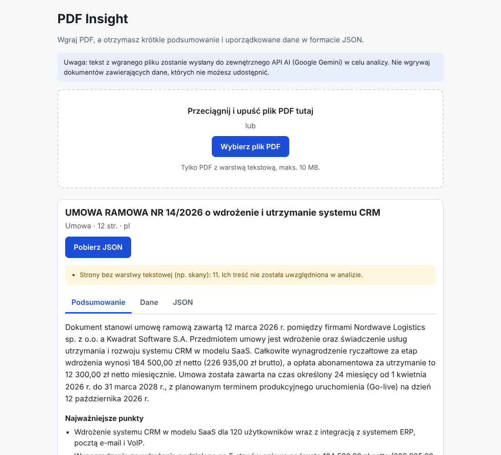

# PDF Insight

Aplikacja webowa, która wczytuje plik PDF, tworzy jego krótkie podsumowanie i zamienia treść w uporządkowane dane JSON (zadanie rekrutacyjne Vibe Coder).

**Demo:** https://arsenilamaka.github.io/pdf-insight-api/



Przykładowy wynik dla dokumentu testowego: [`docs/example-umowa-14-2026.insight.json`](docs/example-umowa-14-2026.insight.json).

## Jak to działa

```
[GitHub Pages: React SPA]               [Cloudflare Worker]              [Google Gemini API]
 drag & drop / wybór PDF                 POST /analyze                    generateContent
 walidacja: typ, sygnatura, 10 MB        CORS: tylko domena demo          responseSchema (JSON)
 pdf.js: tekst strona po stronie  ──►    limit żądań i rozmiaru     ──►
 Zod: walidacja przed wyświetleniem ◄──  Zod + 1 ponowna próba      ◄──
 Podsumowanie / Dane / JSON, pobranie, historia (localStorage)
```

1. Plik jest sprawdzany w przeglądarce (rozszerzenie/MIME, sygnatura `%PDF-`, maks. 10 MB).
2. `pdf.js` wyciąga tekst w przeglądarce. Do AI trafia **tylko tekst**, nie plik. Strony bez warstwy tekstowej (skany) są wykrywane i pokazywane jako ostrzeżenie.
3. Worker przechowuje klucz API (sekret Cloudflare), wysyła tekst do Gemini z wymuszonym schematem odpowiedzi, waliduje wynik Zodem i przy błędnej odpowiedzi ponawia próbę raz.
4. `fileName` i `pages` ustawia kod, nie model. Frontend waliduje wynik tym samym schematem przed wyświetleniem.

## Decyzje

| Decyzja                                                        | Dlaczego                                                                                                                                                                                                                                      |
| -------------------------------------------------------------- | --------------------------------------------------------------------------------------------------------------------------------------------------------------------------------------------------------------------------------------------- |
| Ekstrakcja tekstu w przeglądarce (pdf.js)                      | brak wysyłania pliku binarnego, mniejsze żądanie, worker pozostaje prosty                                                                                                                                                                     |
| Cloudflare Workers                                             | darmowy plan, sekrety, brak serwera do utrzymania przez 14 dni                                                                                                                                                                                |
| Gemini Flash przez alias `gemini-flash-latest` (darmowy limit) | natywny tryb JSON ze schematem, długi kontekst (cały dokument w jednym żądaniu, bez dzielenia), dobra jakość dla języka polskiego; `thinkingLevel: low` dla krótszej odpowiedzi; alias, bo konkretny `gemini-2.5-flash` został wycofany (404) |
| Jeden schemat dla wszystkich typów dokumentów                  | brief definiuje typy `faktura / umowa / oferta / raport / inne`; schemat nie został rozszerzony                                                                                                                                               |
| Brak danych = `null` lub `[]`                                  | zgodnie z briefem; model ma zakaz zgadywania                                                                                                                                                                                                  |
| Treść PDF traktowana jako dane                                 | instrukcja systemowa, tekst w znacznikach `<document>`, wymuszony schemat, walidacja; dokument testowy zawiera próbę prompt injection                                                                                                         |
| Bez routera i bibliotek UI                                     | jedna strona, mniej zależności                                                                                                                                                                                                                |

## Struktura

```
src/
  api/          klient API (timeout, mapowanie błędów, walidacja wyniku)
  components/   UploadZone, ResultView, HistoryList
  lib/          schema (Zod), pdf (pdf.js), walidacja pliku, historia, komunikaty PL
worker/src/     Cloudflare Worker: CORS, limity, prompt, wywołanie Gemini, ponowienie
```

## Uruchomienie lokalne

Wymagania: Node 22.

```bash
npm ci
npm test                     # Vitest
npm run lint && npm run build
```

Produkcyjny worker akceptuje tylko origin demo, dlatego lokalny frontend potrzebuje lokalnego workera:

```bash
cp worker/.dev.vars.example worker/.dev.vars   # wpisz własny GEMINI_API_KEY (plik jest w .gitignore)
cd worker && npx wrangler dev                  # http://localhost:8787
# w drugim terminalu, w katalogu głównym:
echo "VITE_API_URL=http://localhost:8787" > .env.local
npm run dev                                    # http://localhost:5173/pdf-insight-api/
```

### Zmienne środowiskowe

| Gdzie                                            | Zmienna           | Opis                                                                                         |
| ------------------------------------------------ | ----------------- | -------------------------------------------------------------------------------------------- |
| frontend (`.env.local`, GitHub Actions variable) | `VITE_API_URL`    | publiczny adres workera, **nie** sekret                                                      |
| worker (secret)                                  | `GEMINI_API_KEY`  | klucz z Google AI Studio                                                                     |
| worker (var)                                     | `ALLOWED_ORIGINS` | produkcja: `https://arsenilamaka.github.io`; lokalnie (`.dev.vars`): `http://localhost:5173` |
| worker (var, opcjonalnie)                        | `GEMINI_MODEL`    | domyślnie `gemini-flash-latest` (alias aktualnego modelu Flash)                              |

### Worker

Opcja A, panel Cloudflare: `npm run build:worker`, utwórz Worker `pdf-insight-api`, wklej `worker/dist/worker.js`, dodaj sekret `GEMINI_API_KEY` i zmienną `ALLOWED_ORIGINS`.

Opcja B, CLI: w katalogu `worker/` uzupełnij `ALLOWED_ORIGINS` w `wrangler.toml`, następnie `npx wrangler secret put GEMINI_API_KEY` i `npx wrangler deploy`.

### GitHub Pages

Settings → Pages → Source: **GitHub Actions**. Settings → Secrets and variables → Actions → Variables: `VITE_API_URL`. Każdy push do `main` uruchamia lint › test › build › deploy.

## Bezpieczeństwo

- Klucz API istnieje tylko jako sekret workera; nie ma go w kodzie, w `.env` ani w historii Git (`.env*` w `.gitignore`).
- CORS: w produkcji `ALLOWED_ORIGINS` zawiera tylko `https://arsenilamaka.github.io` (dokładny origin, bez ścieżki repozytorium i bez `localhost`); inne originy dostają 403. Lokalnie worker uruchamia się z `worker/.dev.vars` (w `.gitignore`), np. `ALLOWED_ORIGINS=http://localhost:5173`.
- CORS **nie chroni** przed bezpośrednimi żądaniami HTTP: nagłówek `Origin` można podrobić np. w curl. Przed nadużyciem chronią limit żądań na IP, limity rozmiaru i dzienny limit API Gemini.
- Limity: 10 MB pliku, 200 000 znaków tekstu, 1 MB żądania, 10 analiz na 10 minut z jednego IP w obrębie instancji workera (bez bindingu `RATE_LIMITER` nie jest to limit globalny).
- Brak `dangerouslySetInnerHTML`; wyniki AI są renderowane jako tekst.
- Interfejs informuje, że tekst pliku trafia do zewnętrznego API AI.

## Znane ograniczenia

- Dokumenty z mniej niż 200 znakami tekstu są odrzucane przed wysłaniem do AI, bo schemat (3–5 zdań, 3–7 punktów) wymusiłby zmyślanie treści.
- **Skany bez warstwy tekstowej nie są analizowane** (OCR to punkt COULD). Strony-skany są wykrywane i zgłaszane. W dokumencie testowym dotyczy to strony 11 (Aneks nr 1), więc zmiany z aneksu nie trafiają do wyniku.
- Limit żądań w workerze działa w obrębie jednej instancji (best effort). Dla twardego limitu można podpiąć binding `RATE_LIMITER` (Workers Rate Limiting), obsługiwany przez kod.
- Darmowy limit Gemini jest ograniczony dziennie i może się zmienić; po jego wyczerpaniu aplikacja pokazuje komunikat o błędzie.
- Na darmowym planie Google może wykorzystywać przesłane dane do ulepszania usług; nie wgrywaj poufnych dokumentów.
- Dokumenty dłuższe niż 200 000 znaków są obcinane z ostrzeżeniem (brak dzielenia na fragmenty, F-08).
- Liczba zdań podsumowania (3–5) jest wymuszana promptem, nie walidacją (podział na zdania w języku polskim jest zawodny przez skróty typu „sp. z o.o.”).
